# agenticFPV

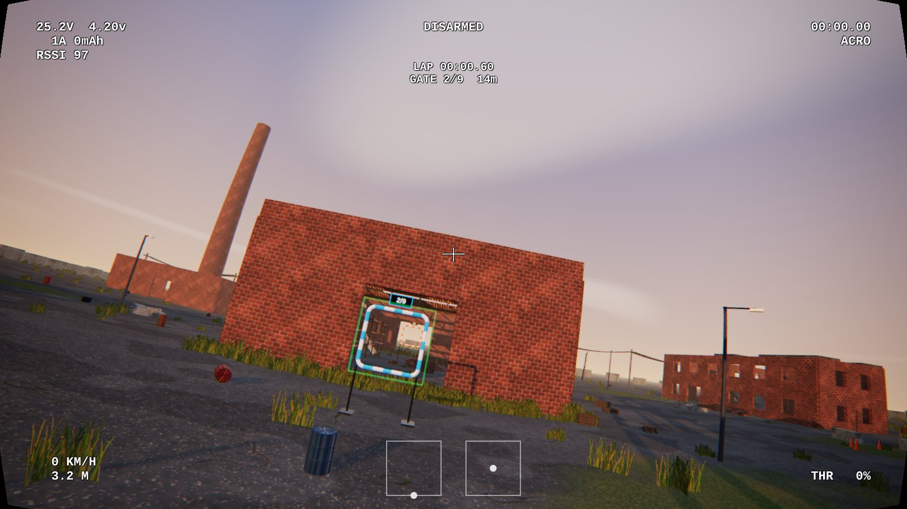

A browser-based FPV drone simulator in the spirit of Velocidrone and Liftoff. It has:

- A Betaflight-style flight controller.
- Real USB RC-transmitter and gamepad support.
- Six quad classes.
- Race, practice and track-editor modes.
- Synthesised motor audio and simulated analog or digital video.
- An abandoned-industrial map.

It's built on Three.js, and everything works with no downloaded assets.

## Screenshots

|                                                                                                                         |                                                                                                            |
| ----------------------------------------------------------------------------------------------------------------------- | ---------------------------------------------------------------------------------------------------------- |
| 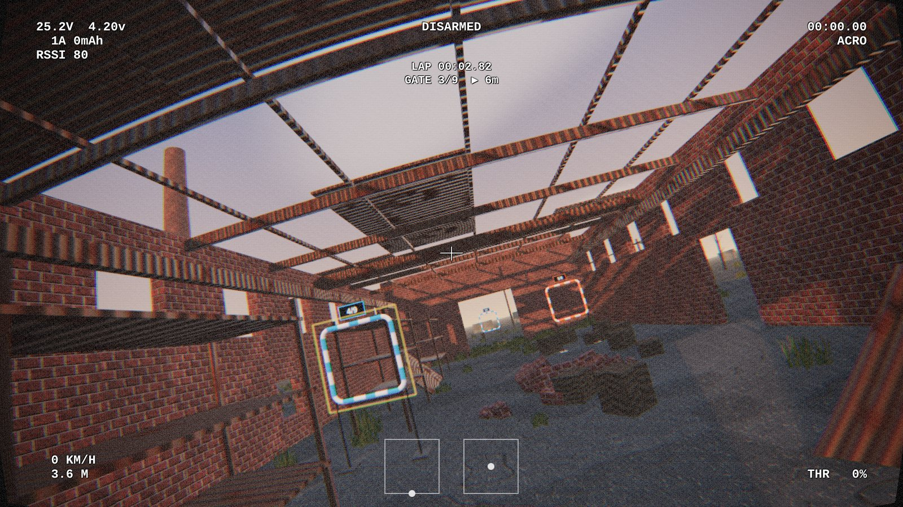 | 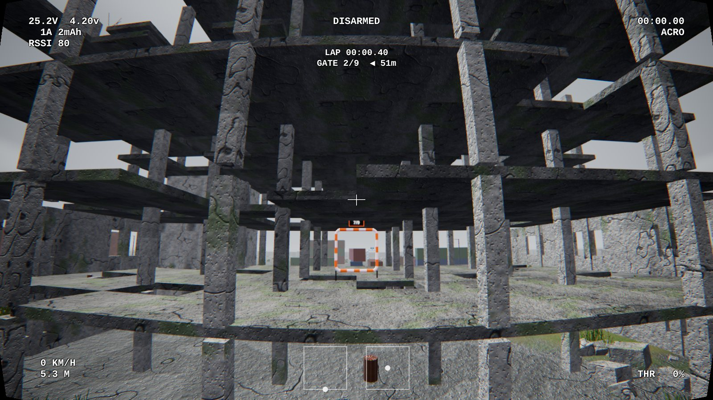 |
| **Warehouse Sprint**: through the collapsed roof, analog link                                                           | **Works Circuit**: skeleton floor-2 gate, overcast                                                         |
| 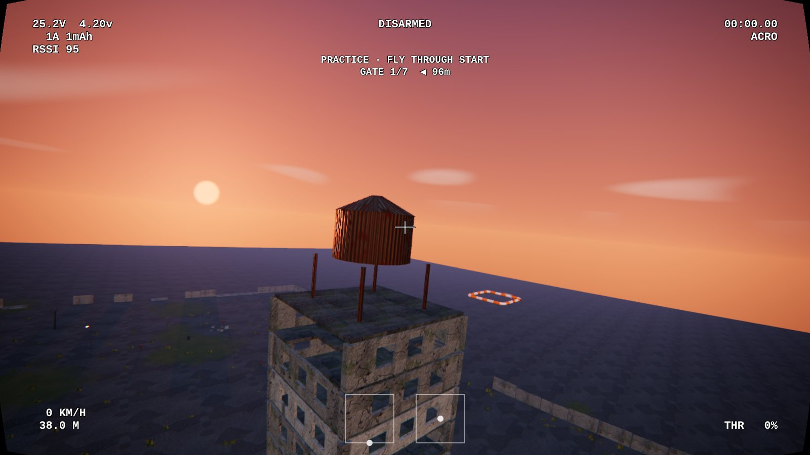                | 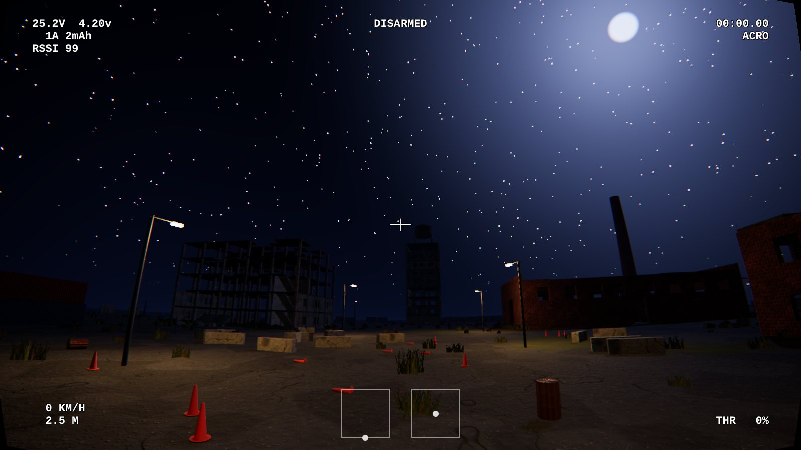                            |
| **Tower Dive**: dusk, dive gate below                                                                                   | **Night**: street lamps and stars                                                                          |
| 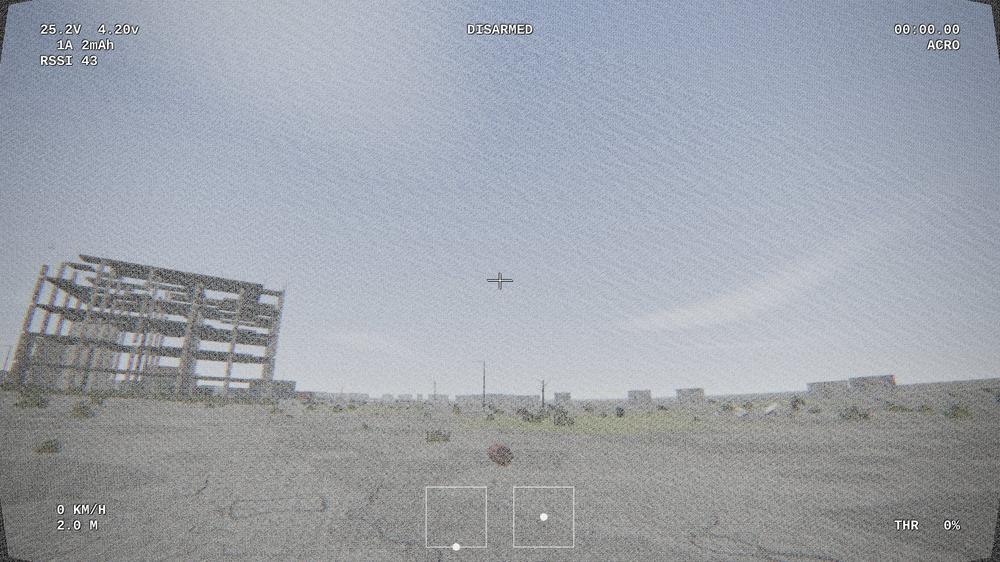                                | 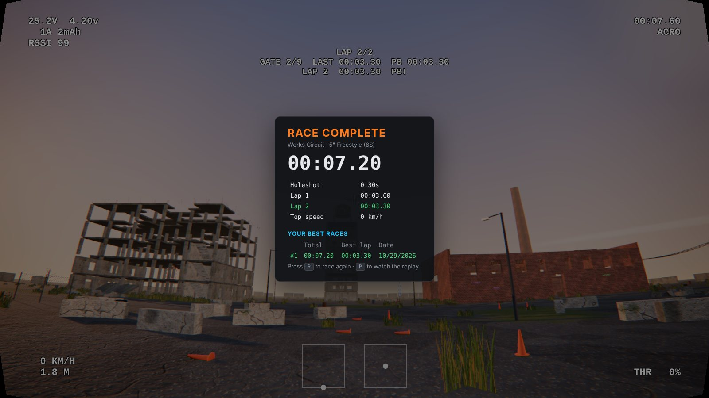                |
| **Analog breakup** at range and behind walls                                                                            | **Race mode**: results and local leaderboard                                                               |

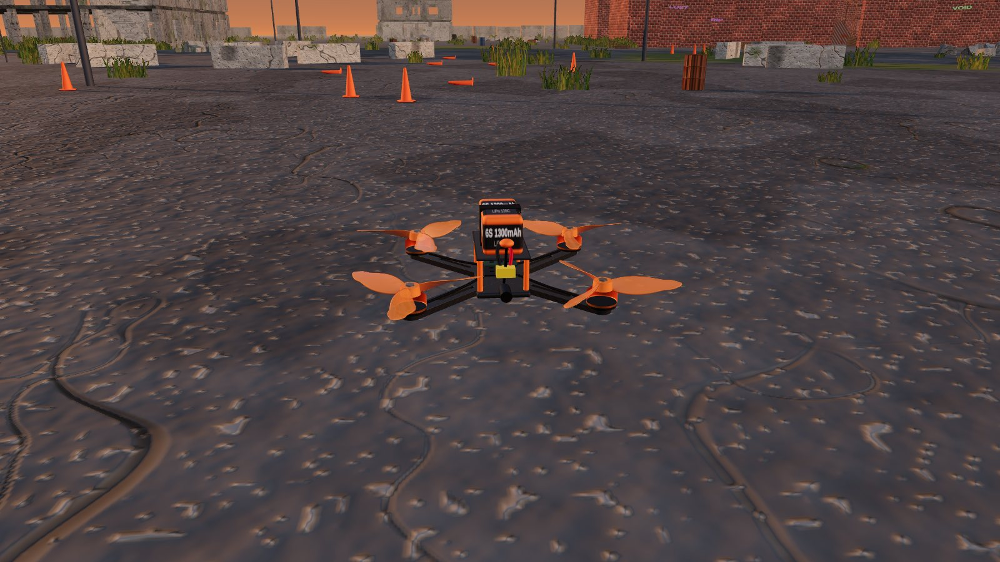

### Six quad classes, each with its own model and tune

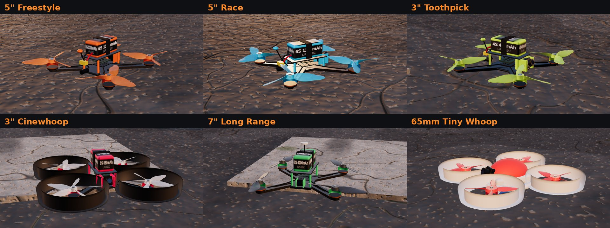

### Settings

|                                                                                               |                                                                                                         |
| --------------------------------------------------------------------------------------------- | ------------------------------------------------------------------------------------------------------- |
| 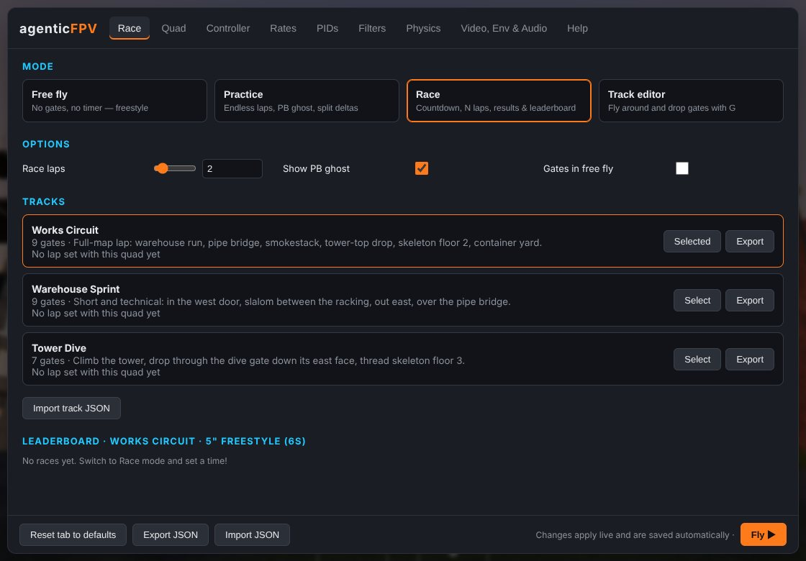                   | 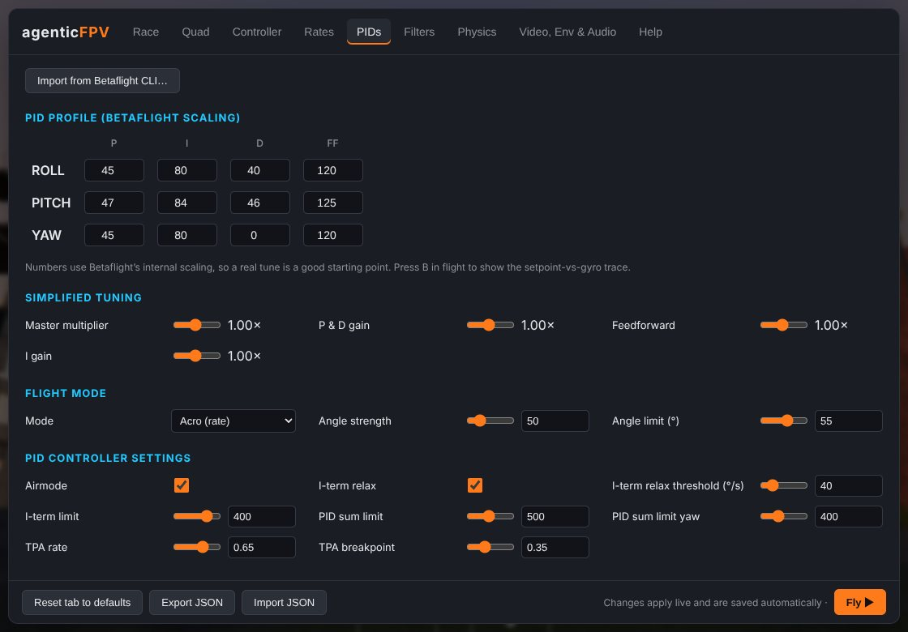 |
| 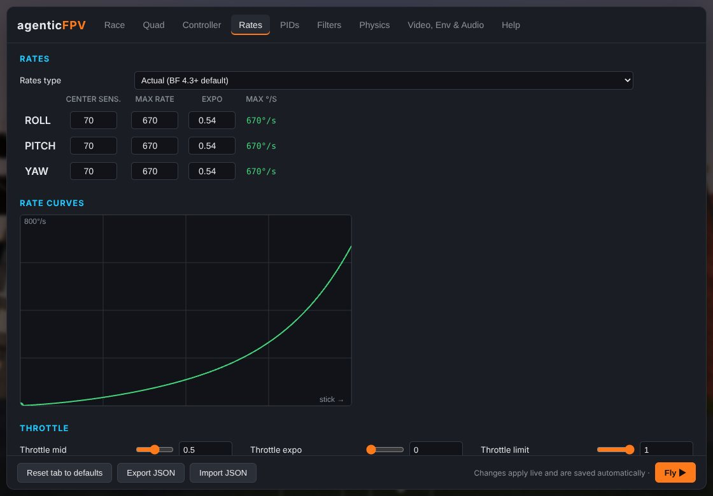 | 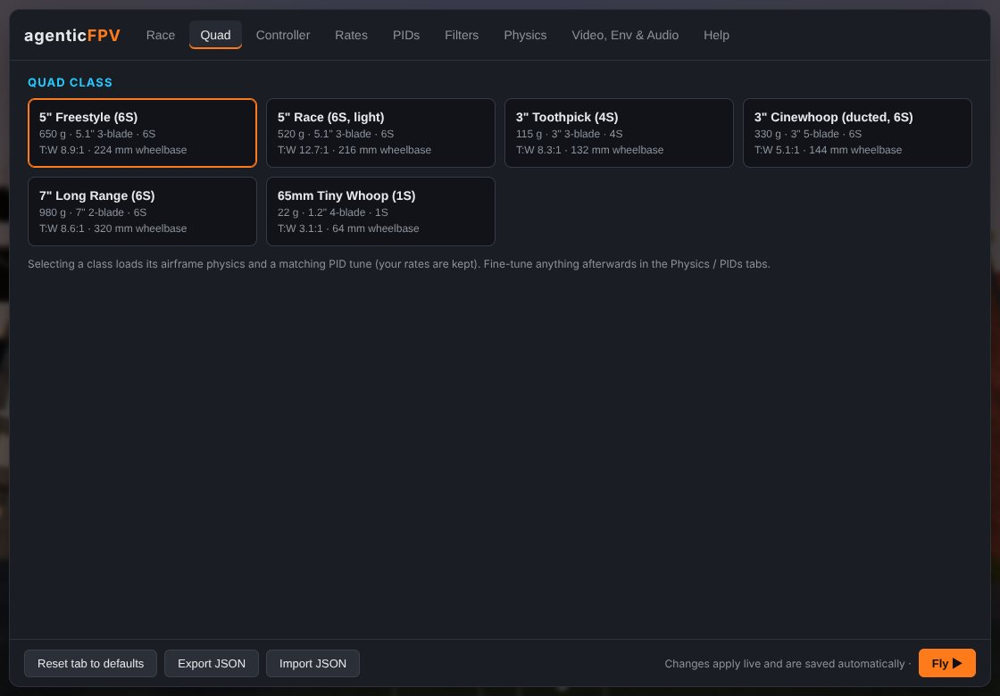                                           |

<sub>Screenshots were captured with the in-repo build in headless Chromium.</sub>

## Quick start

Requires Node 22.18 or newer.

```bash
npm install
npm run dev            # http://localhost:5173
```

```bash
npm run build          # type-check + static build in dist/ (relative paths, host anywhere)
npm run preview        # serve the build
npm run fetch-assets   # optional: download CC0 Poly Haven photo textures (see below)
```

Pushing to `main` deploys the build to GitHub Pages through `.github/workflows/pages.yml`. To turn it on,
go to **Settings → Pages → Source: GitHub Actions**.

## Tech stack

| Layer     | Choice                                                                                                       |
| --------- | ------------------------------------------------------------------------------------------------------------ |
| Language  | TypeScript (strict, `erasableSyntaxOnly`, `verbatimModuleSyntax`)                                            |
| 3D engine | Three.js, driven imperatively by a `Simulator` class (fixed-step 1 kHz physics, render loop, input, audio)   |
| UI        | React 19 for the settings menu and HUD. Per-frame HUD values are written through refs, not React re-renders. |
| State     | Zustand stores (Immer + persist) for config and UI state. The engine subscribes to the config slices it uses |
| Config    | One Zod schema gives the `Config` type, defaults, and forgiving validation of saved or imported settings     |
| Build     | Vite                                                                                                         |
| Quality   | ESLint (typescript-eslint, React Hooks / React Compiler rules), Prettier                                     |
| Tests     | Vitest (unit + jsdom component tests with Testing Library), Playwright (end-to-end + visual)                 |

## Testing

```bash
npm test               # all Vitest suites (unit + component), ~6 s
npm run test:unit      # physics, flight controller, presets, race logic, config schema, input, replay…
npm run test:component # React UI in jsdom: settings fields, tabs, CLI import, calibration wizard, overlays
npm run test:coverage  # Vitest with v8 coverage (HTML report in coverage/)
npm run test:e2e       # Playwright: boots the real build in Chromium and flies it
npm run test:visual    # Playwright screenshot comparisons of every settings tab
npm run test:all       # typecheck + lint + coverage + e2e (what CI runs)
```

- **Unit tests** (`test/unit/`) run the flight controller and quad physics headlessly at 1 kHz. They check
  hover throttle, step response and overshoot on every axis for every quad class, top speed, flips, ground
  contact, turtle mode and wind. Pure game logic (race session, replay buffer, calibration wizard, config
  validation and migration, Betaflight CLI import, video-link model, texture tiling) is covered too.
- **Component tests** (`test/component/`) render the React UI against the real stores, with a fake
  simulator and gamepad where needed.
- **End-to-end tests** (`e2e/`) drive the production build in Chromium with software WebGL (SwiftShader), so
  they run the same on GPU-less CI machines. They arm and fly with the keyboard, crash into walls, change
  settings and check they reach the engine and survive a reload, run a full race (the quad is teleported
  through each gate, frame by frame, through the real loop), build and save a track in the editor, and use
  the replay. The app exposes `window.__fpv` (simulator, config, UI store) for this.
- **Visual tests** (`e2e/visual.spec.ts`) compare screenshots of each settings tab. Baselines depend on
  the OS and fonts, so they're kept per platform. Run `npm run test:visual:update` to create them locally.

CI (`.github/workflows/ci.yml`) runs typecheck, lint, format check, Vitest with coverage, the build, and
the Playwright end-to-end suite on every push and pull request.

## Features

| Area                  | What you get                                                                                                                                                                                                                                                          |
| --------------------- | --------------------------------------------------------------------------------------------------------------------------------------------------------------------------------------------------------------------------------------------------------------------- |
| **Flight model**      | 1 kHz rigid body. Each motor has spin-up/spin-down lag, and thrust scales with rpm². Also: prop inflow loss, yaw torque from prop drag and rotor acceleration, per-axis drag plus rotor H-force drag, prop-wash turbulence, battery sag, wind with gusts.             |
| **Collisions**        | The quad collides as 6 spheres (4 props, the body and the battery) with rigid-body impulses and friction, so it tumbles and comes to rest realistically. Crash-on-impact is optional.                                                                                 |
| **Turtle mode**       | Betaflight crash-flip with reversible motors. It is latched at arming (switch or `T`), then you push the sticks toward the side you want to flip.                                                                                                                     |
| **Flight controller** | Betaflight scaling for P/I/D/FF. RC smoothing, gyro and D-term low-pass filters, I-term relax, TPA, airmode with an activation threshold, angle mode. Actual and classic Betaflight rates.                                                                            |
| **Betaflight import** | Paste a CLI `diff all` (PIDs tab) to import PIDs, rates, TPA, filters, idle and airmode from your real quad.                                                                                                                                                          |
| **Quad classes**      | 5" freestyle, 5" race, 3" toothpick, 3" cinewhoop, 7" long range and 65 mm tiny whoop. Each class has a tune checked by tests and its own detailed procedural model: twisted-airfoil props, motor bells, ducts, FC stack, a strapped LiPo.                            |
| **Game modes**        | Free fly, Practice (endless laps, a ghost of your personal best, split deltas), Race (countdown, holeshot, N laps, missed-gate warnings, results card, local leaderboard), Track editor.                                                                              |
| **Tracks**            | Works Circuit, Warehouse Sprint and Tower Dive (with tilted and dive gates), plus your own tracks. Tracks can be imported and exported as JSON.                                                                                                                       |
| **Replay**            | DVR of the last 90 s (`P`): seek, change speed, pause, switch camera.                                                                                                                                                                                                 |
| **Audio**             | WebAudio synthesis driven by simulated rpm: motor whine, blade-pass tones, prop noise, prop-wash flutter, wind rush, impacts.                                                                                                                                         |
| **Video**             | Fisheye lens, chromatic aberration, vignette. The analog link gets static and breakup; the digital HD link gets blocking and freezes. Both depend on distance and on the number of walls between you and the quad. VTX power is selectable. The OSD shows RSSI or LQ. |
| **Environment**       | Midday, golden hour, overcast, dusk and night (with street lamps). Lighting uses CC0 Poly Haven HDRIs.                                                                                                                                                                |
| **Effects**           | GPU particle prop-wash dust that kicks up off the ground, slabs and roofs (grass clippings over grass), crash debris bursts, and instanced grass that sways in the wind and flattens and flutters under the prop wash.                                                |
| **Cameras**           | FPV (FOV and uptilt adjustable), chase, line of sight, orbit.                                                                                                                                                                                                         |

## Controllers

1. Put your radio in **USB Joystick (HID)** mode (EdgeTX/OpenTX: plug in → _USB Joystick_). A gamepad also works.
2. Press any stick or button so the browser exposes the device.
3. Press **Esc** → **Controller** → **Run calibration wizard**. The wizard detects axes and their
   directions, records stick ranges and centres, and learns your arm switch. You can also map an
   angle-mode switch and a turtle switch.
4. Arming works like Betaflight: switch on with throttle low.

Keyboard fallback:

- **Throttle:** `W`/`S`, and `X` cuts it.
- **Yaw:** `A`/`D`.
- **Pitch/roll:** arrow keys.
- **Arm:** `Space`.
- **Turtle mode:** `T`.

Angle mode (`M`) makes keyboard flying much easier.

| Key               | Action                                                              |
| ----------------- | ------------------------------------------------------------------- |
| `Esc` / `Tab`     | Settings (pauses)                                                   |
| `R`               | Reset / restart race                                                |
| `C`               | Camera: FPV → chase → LOS → orbit                                   |
| `M`               | Acro ↔ Angle                                                        |
| `T`               | Turtle mode (takes effect when you next arm)                        |
| `P`               | Replay (`←`/`→` seek, `↑`/`↓` speed, `Space` pause)                 |
| `G` / `Backspace` | Track editor: place a gate ahead of the quad / remove the last gate |
| `B`               | Blackbox trace (setpoint vs gyro)                                   |
| `H`               | Help                                                                |

## Textures & assets

Everything ships procedurally, so the repo contains no binary art:

- **Materials:** tileable fBm heightfields generate albedo, normal and roughness maps for concrete,
  brick, asphalt, rusted and painted corrugated metal, and wood (`src/engine/world/pbrRecipes.ts`).
- **HDRIs:** CC0 [Poly Haven](https://polyhaven.com) images bundled through
  [`@pmndrs/assets`](https://github.com/pmndrs/assets) (CC0).

**Photo textures (optional).** `npm run fetch-assets` downloads CC0 PBR texture sets from Poly Haven
into `public/textures/`. It also writes `manifest.json` and `CREDITS.md` there. On the next load the game
uses them automatically; without them it falls back to the procedural textures.

## Layout

```
src/
  main.tsx                  boots the Simulator, mounts React, exposes window.__fpv
  engine/
    Simulator.ts            renderer, cameras, fixed-step loop, arming, video-link sim
    sim/                    rates, filters, flight controller, quad physics, collision, presets, BF CLI import
    game/                   tracks + records, race session (laps, splits, ghost), gates, replay, game modes
    world/                  map builder, procedural PBR, quad models, decal/alpha textures
    render/                 environment (sky, sun, IBL, time of day), video post-FX, prop-wash dust, grass wind
    audio/motorAudio.ts     WebAudio motor synth
    input/input.ts          gamepad/RC mapping, calibration wizard, keyboard
  state/                    Zod config schema, Zustand stores (config, UI, engine)
  ui/                       React: App, HUD (OSD, sticks, blackbox, overlays), settings menu + tabs
scripts/fetch-assets.ts     optional CC0 texture download (runs directly on Node)
test/unit/                  Vitest unit tests (node; jsdom where storage is involved)
test/component/             Vitest + Testing Library component tests (jsdom)
e2e/                        Playwright end-to-end and visual tests
PLAN.md                     milestones + progress log
```
